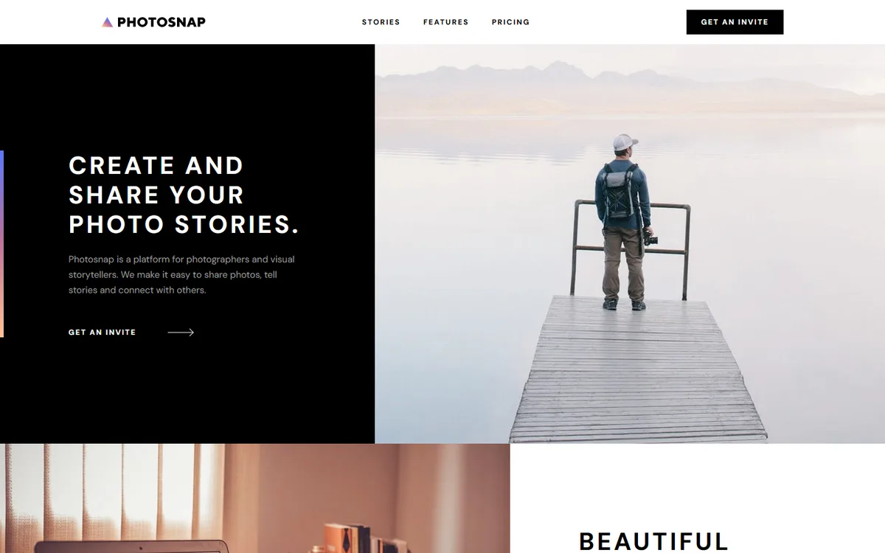

# Photosnap

A four-page photography website with responsive editorial layouts and an interactive pricing comparison.

[Live demo](https://photosnap-ui.vercel.app) · [Original challenge brief](docs/challenge-brief.md)



## Built with

React 19 · TypeScript · Vite · React Router · CSS Modules · Vitest · Playwright · axe-core

## Features

- Home, Stories, Features, and Pricing pages with shared navigation and footer.
- Featured story plus sixteen photo cards, responsive imagery, and alternating photo/text compositions.
- Basic, Pro, and Business pricing with monthly/yearly selection and a responsive feature comparison.
- Mobile menu with Escape and outside-click dismissal, focus handling, and scroll locking.
- Keyboard controls, skip link, reduced-motion support, and accessible comparison headers.

## Implementation notes

`src/App.tsx` defines route pages and the shared layout. `src/pricing.ts` isolates pricing logic, `src/data.ts` holds page content, and `src/components.tsx` provides reusable UI pieces.

Routes include `/`, `/stories`, `/features`, and `/pricing`. The original `.html` paths also resolve to their matching pages. Billing selection is temporary React state; no server or storage is needed. Fonts are bundled locally from Fontsource.

## Run locally

Use Node.js 24 and npm. No environment variables or external services are required.

```sh
npm ci
npm run dev -- --port 5188
```

Open `http://127.0.0.1:5188`.

```sh
npm run build
npm run preview -- --port 5189
```

Vercel deploys pushes to `main`. `vercel.json` configures the `dist/` output and application-route fallback.

## Verification

```sh
npm test
npm run build
npm run test:e2e
```

The deployment verification on 12 October 2026 passed TypeScript, the production build, and all 3 pricing tests. Existing browser tests cover page navigation, history, pricing state, menu dismissal, focus, images, responsive overflow, and automated accessibility scans.

Install Chromium once with `npx playwright install chromium`. To use installed Chrome, set `PLAYWRIGHT_CHANNEL=chrome`; in PowerShell, use `$env:PLAYWRIGHT_CHANNEL = 'chrome'`. Playwright starts the development server on port 5188 and stores reports and screenshots under ignored `node_modules/.cache/` paths. Automated accessibility scans do not replace assistive-technology testing.

## Demo scope and attribution

Invite, story, and plan links intentionally do not submit forms or navigate to a service, following the challenge requirements. This demo does not publish stories, sell subscriptions, or provide a backend.

Challenge content, photographs, and icons: [Frontend Mentor](https://www.frontendmentor.io). DM Sans uses the SIL Open Font License through Fontsource. Supplied starter materials and premium design-file exclusions are retained. The screenshot shows the implemented app; `preview.jpg` retains the supplied homepage reference. Full page design exports were not supplied.
