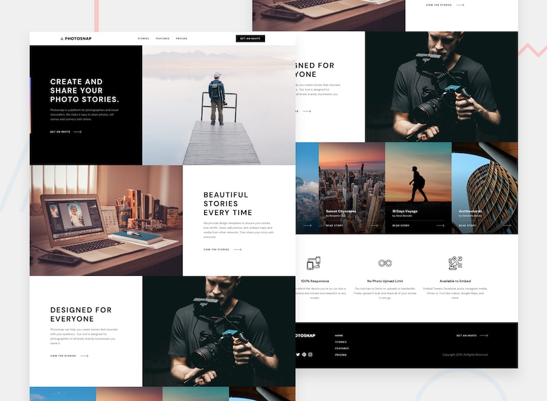

# Photosnap — React implementation

Live demo: [View site](https://photosnap-multi-page-website-brown.vercel.app) | [GitHub repository](https://github.com/mohliman/photosnap-multi-page-website)

Four responsive pages built with React, TypeScript, Vite, React Router and CSS Modules. Original starter HTML, image assets, SVGs, preview, challenge instructions and gitignore files are preserved. DM Sans is bundled locally through Fontsource; the application does not require a font service at runtime.

## Run locally

Use Node.js 24 LTS and npm (verified with Node 24.16.0).

```sh
npm ci
npm run dev -- --port 5188
```

Preview: http://127.0.0.1:5188/. Routes: `/`, `/stories`, `/features` and `/pricing`. Original `/index.html`, `/stories.html`, `/features.html` and `/pricing.html` paths also render the application. Unknown paths show a recovery page.

## Production

```sh
npm run build
npm run preview -- --port 5189
```

The build checks TypeScript and emits the application, fonts and supplied assets into `dist/`. A production static host must serve `index.html` for application routes (SPA fallback). No backend, API keys or environment variables are required. Vercel is connected to this GitHub repository; pushes to `main` deploy automatically.

## Implemented behavior

- Home: three alternating photo and text sections, four featured stories, three feature summaries.
- Stories: the featured Appalachia story and sixteen photo cards with dates and authors. The duplicated World Tour entry in the starter is included once.
- Features: six supplied feature descriptions and icons, plus the beta invitation banner.
- Pricing: Basic, Pro and Business plans, keyboard-operable monthly/yearly switch, annual prices derived from ten monthly payments, responsive feature comparison.
- Shared navigation, footer, mobile disclosure with Escape and outside-click dismissal, scroll locking, responsive breakpoint reset and focus management after navigation.
- Supplied responsive photography, hover/focus styles, reduced-motion support, semantic landmarks, skip link, accessible comparison headers and image descriptions.

As explicitly required by the challenge, invite, story and plan calls to action are anchors without destinations. They prevent hash navigation and do not simulate sign-up, story publishing or checkout. Social icons link to each platform's homepage; no Photosnap social accounts were supplied. Billing selection is temporary React state; there is no persistence requirement.

## Verification

```sh
npm test
npm run test:e2e
npm run build
npm audit
```

For browser tests, install Chromium once with `npx playwright install chromium`. To use an existing Chrome installation instead, set `PLAYWRIGHT_CHANNEL=chrome` (PowerShell: `$env:PLAYWRIGHT_CHANNEL = 'chrome'`). Playwright starts or reuses the local server on port 5188. Tests use one worker and load offscreen images sequentially to reduce resource spikes. Screenshots, the JSON browser report and failure traces are generated under the ignored `node_modules/.cache/` directory.

Verification includes pricing calculation/state tests; browser navigation and history; sixteen story links; keyboard billing; menu dismissal and focus; image and console checks; responsive screenshots and overflow checks at 1440, 768, 600, 375 and 320 pixels; and automated axe WCAG A/AA scans on all pages and the mobile menu/comparison. Automated accessibility scans do not replace assistive-technology testing.

Final verification: 13 browser tests and 3 pricing tests pass, the production build passes, and `npm audit` reports zero vulnerabilities. Browser screenshots were visually inspected for all four pages. A prior parallel browser run hit host resource exhaustion; the final sequential run completed successfully.

Only `preview.jpg`, a composite home-page preview, was supplied. No detailed design exports, Figma file, font files or style guide are present. Home was visually compared with that preview; other pages follow the supplied content, images and shared design language. Exact comparison against unavailable page designs remains a limitation. The in-app browser automation could not initialize in this session; browser verification used Playwright with installed Chrome.

## Attribution and assets

Challenge content, imagery and icons are supplied by [Frontend Mentor](https://www.frontendmentor.io). Keep premium design files private and retain the supplied `.gitignore` rules. DM Sans is distributed through `@fontsource/dm-sans` under the SIL Open Font License; its license is included in that installed package. Original challenge instructions and attribution follow below.

---

# Frontend Mentor - Photosnap Website



## Welcome! 👋

Thanks for purchasing this premium Frontend Mentor coding challenge.

[Frontend Mentor](https://www.frontendmentor.io) challenges help you improve your coding skills by building realistic projects. These premium challenges are perfect portfolio pieces, so please feel free to use what you create in your portfolio to show others.

**To do this challenge, you need a solid understanding of HTML and CSS and a basic understanding of JavaScript.**

## The challenge

Your challenge is to build out this multi-page website and get it looking as close to the design as possible.

You can use any tools you like to help you complete the challenge. So if you've got something you'd like to practice, feel free to give it a go.

Your users should be able to:

- View the optimal layout for each page depending on their device's screen size
- See hover states for all interactive elements throughout the site

### Want some support on the challenge?

[Join our community](https://www.frontendmentor.io/community) and ask questions in the **#help** channel.

### Expected Behaviour

The following points are to clarify behaviour for areas where you might not be sure what's expected.

#### Multiple Pages

- The "Get an invite" call-to-action throughout the site should be an anchor tag, but doesn't link anywhere. If this was a real website, this could link to a sign-up or application form.

#### Stories

- If this were a real site, each item on this page would be clickable and could link off to each of these stories in their own sites. So each item should be wrapped with an anchor tag, but it won't link anywhere on this project.

#### Pricing

- The "Pick a plan" call-to-actions in the pricing tiers should be anchor tags, but they don't link anywhere. If this was a real website, this could link to a checkout form.

## Where to find everything

Your task is to build out the project to the design file provided. You can download the Figma design file on the platform. **Please be sure not to share it with anyone else.** The design download comes with a `README.md` file as well to help you get set up.

All the required assets for this project are in the `/assets` folder. The assets are already exported for the correct screen size and optimized. Some images are reusable at multiple screen sizes. So if you don't see an image in a specific folder, it will typically be in another folder for that page.

The design system in the design file will give you more information about the various colors, fonts, and styles used in this project.

## Using AI coding assistants

We've included two files to help you if you're using AI coding assistants (like Claude, GitHub Copilot, Cursor, etc.) while working on this challenge:

- `AGENTS.md` - Contains detailed instructions for AI assistants on how to help you with this challenge. It's tailored to this challenge's difficulty level, so the AI will provide guidance appropriate to your learning stage—offering more support for beginner challenges and encouraging more independence on advanced ones.
- `CLAUDE.md` - A pointer file that directs Claude-based tools to the AGENTS.md instructions.

**How to use them:** You don't need to do anything! These files are automatically detected by most AI coding tools. The AI will read them and adjust its behavior to be a better learning partner—guiding you toward solutions rather than just giving you the answers.

**Note:** These files are designed to help you *learn*, not to do the work for you. The AI is instructed to ask questions, give hints, and explain concepts rather than writing complete solutions.

## Building your project

Feel free to use any workflow that you feel comfortable with. Below is a suggested process, but do not feel like you need to follow these steps:

1. Separate the `starter-code` from the rest of this project and rename it to something meaningful for you. Initialize the codebase as a public repository on [GitHub](https://github.com/). Creating a repo will make it easier to share your code with the community if you need help. If you're not sure how to do this, [have a read-through of this Try Git resource](https://try.github.io/). **⚠️ IMPORTANT ⚠️: There are already a couple of `.gitignore` files in this project. Please do not remove them or change the content of the files. If you create a brand new project, please use the `.gitignore` files provided in your new codebase. This is to avoid the accidental upload of the Figma design file to GitHub. With these premium challenges, please be sure not to share the design file in your GitHub repo. Thanks!**
2. Configure your repository to publish your code to a web address. This will also be useful if you need some help during a challenge as you can share the URL for your project with your repo URL. There are a number of ways to do this, and we provide some recommendations below.
3. Look through the designs to start planning out how you'll tackle the project. This step is crucial to help you think ahead for CSS classes to create reusable styles.
4. Before adding any styles, structure your content with HTML. Writing your HTML first can help focus your attention on creating well-structured content.
5. Write out the base styles for your project, including general content styles, such as `font-family` and `font-size`.
6. Start adding styles to the top of the page and work down. Only move on to the next section once you're happy you've completed the area you're working on.

## Deploying your project

As mentioned above, there are many ways to host your project for free. Our recommended hosts are:

- [GitHub Pages](https://pages.github.com/)
- [Vercel](https://vercel.com/)
- [Netlify](https://www.netlify.com/)

You can host your site using one of these solutions or any of our other trusted providers. [Read more about our recommended and trusted hosts](https://www.frontendmentor.io/guides/hosting-your-solution).

## Create a custom `README.md`

We strongly recommend overwriting this `README.md` with a custom one. We've provided a template inside the [`README-template.md`](./README-template.md) file in this starter code.

The template provides a guide for what to add. A custom `README` will help you explain your project and reflect on your learnings. Please feel free to edit our template as much as you like.

Once you've added your information to the template, delete this file and rename the `README-template.md` file to `README.md`. That will make it show up as your repository's README file.

## Submitting your solution

Submit your solution on the platform for the rest of the community to see. Follow our ["Complete guide to submitting solutions"](https://www.frontendmentor.io/guides/how-to-submit-solutions) for tips on how to do this.

Remember, if you're looking for feedback on your solution, be sure to ask questions when submitting it. The more specific and detailed you are with your questions, the higher the chance you'll get valuable feedback from the community.

**⚠️ IMPORTANT ⚠️: With these premium challenges, please be sure not to upload the design file to GitHub when you're submitting to the platform and sharing it around. If you've created a brand new project, the easiest way to do that is to copy across the `.gitignore` provided in this starter project.**

## Sharing your solution

There are multiple places you can share your solution:

1. Share your solution page in the **#finished-projects** channel of the [community](https://www.frontendmentor.io/community).
2. Share on [X (formerly Twitter)](https://x.com/frontendmentor) and mention **@frontendmentor**, including the repo and live URLs in your post. We'd love to take a look at what you've built and help share it around.
3. Share your solution on [LinkedIn](https://www.linkedin.com/company/frontend-mentor/).
4. Blog about your experience building your project. Writing about your workflow, technical choices, and talking through your code is a brilliant way to reinforce what you've learned. Great platforms to write on are [dev.to](https://dev.to/), [Hashnode](https://hashnode.com/), and [CodeNewbie](https://community.codenewbie.org/).

We provide templates to help you share your solution once you've submitted it on the platform. Please do edit them and include specific questions when you're looking for feedback.

The more specific you are with your questions the more likely it is that another member of the community will give you feedback.

## Got feedback for us?

We love receiving feedback! We're always looking to improve our challenges and our platform. So if you have anything you'd like to mention, please email hi[at]frontendmentor[dot]io.

**Have fun building!** 🚀
